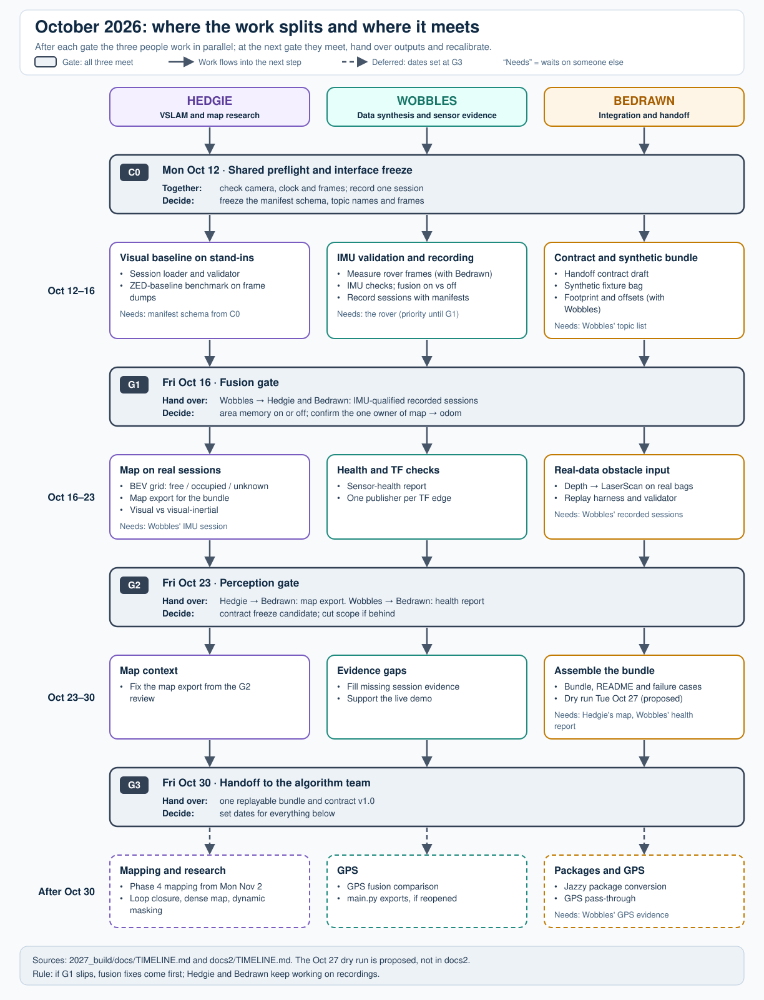

# Subteam Timeline: Data Synthesis, VSLAM, and Integration

The visual roadmap is [`pipeline.svg`](pipeline.svg). Its source of truth is [`scripts/generate_pipeline_svg.py`](scripts/generate_pipeline_svg.py), not the generated SVG.

Regenerate it from the repository root after changing timeline content:

```bash
python3 2027_build/docs/scripts/generate_pipeline_svg.py
```

## Agreed delivery order

1. **Short shared measurement preflight:** establish camera/IMU timing, fixed physical frames, and one replayable recording. This supplies the evidence needed to interpret IMU measurements; it is not a separate camera-only feature phase.
2. **Parallel subteam work:** data synthesis creates/records replayable sessions and validates IMU evidence; VSLAM establishes visual and visual-inertial trajectory/map evidence; integration prepares the synthetic fixture and final handoff contract.
3. **Bundle gate:** verify one replayable Navigation Data & VSLAM Handoff Bundle against the manifest, sensor-topic/TF, VSLAM map/trajectory, obstacle, and single-`map -> odom` contracts.
4. **Package conversion:** convert only the vertical slices proven at integration. Minimal scaffolding may exist earlier; do not migrate the legacy prototype merely to fill the target workspace.
5. **GPS:** evaluate global localization after the local stack and its replay evidence are stable.

The responsibilities can start independently, but all three are complete only when their evidence is assembled into the validated handoff bundle. The next subteam owns costmap construction, route decisions, planning/control, and motors.

## Can the three workstreams run at the same time?



[schedule_flow.svg](schedule_flow.svg) shows where the work splits and where it meets. Regenerate it with `python3 2027_build/docs/scripts/generate_schedule_svg.py` after changing the dates or tables below.

Mostly, but not entirely. After the shared preflight, each person starts against stand-ins (synthetic fixtures, frame dumps, `fake_pose`). That lets most of their work run in parallel. These items still wait on someone else, compete for the rover, or fall outside the October scope. Prompt numbers refer to the "Agent prompts by phase" section in each person's plan.

| Work | Waits on | Ready by | Until then |
| --- | --- | --- | --- |
| Hedgie session IO (3), Bedrawn fixture and contract (3, 4) | Manifest schema (shared 2) and Wobbles' topic list (Wobbles 4) | C0, Mon Oct 12 | Draft against `docs/contract/` and `docs2/OUTPUT_CONTRACT.md` |
| Wobbles frames (3) and Bedrawn footprint (6) | The rover, in one tape-measure session | Before G1, Fri Oct 16 | Not applicable: do it together |
| Live camera time | Wobbles has priority until G1 (docs2 rule 2, fusion first) | G1, Fri Oct 16 | Hedgie and Bedrawn work from recordings |
| Hedgie visual vs visual-inertial (11), Bedrawn real data (8) | An IMU-qualified session (Wobbles 7, 11) | G1, Fri Oct 16 | Synthetic fixture and frame dumps |
| Hedgie map export (12) | Bedrawn's contract draft (Bedrawn 3) | C0 draft; frozen at G2 | Export the docs2 local-grid format |
| Bedrawn bundle (9) | Hedgie map export (12) and Wobbles health report (10) | G2, Fri Oct 23 | Bundle without map context |
| Hedgie research VSLAM (6, 7, 8, 10), dynamic masking (9) | Out of October scope (docs2); would take time from G2 | After G3, Fri Oct 30 | Visual baseline only (3 to 5) |
| `main.py` exports (Wobbles 8) | Conflicts with docs2 D8 (`main.py` untouched) | After Oct 30, if reopened | Bag topics replace them |
| Package conversion to Jazzy (Bedrawn 10) | Bundle gate passed | After G3 | docs2 Humble packages |
| All GPS work (Wobbles 12, Hedgie 13, Bedrawn 11) | Wobbles GPS evidence; out of October scope | After G3 | None |

## Key dates and sync meetings (October 2026 milestone)

The gate dates come from [`docs2/TIMELINE.md`](../../docs2/TIMELINE.md). Each gate is also a meeting for all three people: check the evidence, recalibrate the plan, and agree on what changes. The Oct 27 dry run is a proposed addition that docs2 does not have. Without it, any problem with the handoff would first show up on Oct 30, the gate day itself.

| Date | Meeting | Wobbles brings | Hedgie brings | Bedrawn brings | Decide or recalibrate |
| --- | --- | --- | --- | --- | --- |
| **Mon Oct 12** (C0) | Interface freeze | Topic list, frames, preflight session | Loader running on frame dumps | Contract draft, synthetic fixture | Freeze the manifest schema and topic names. If anything is still open on Oct 13, close it before Oct 16. |
| **Fri Oct 16** (G1) | Fusion gate | TF tree, IMU checks, fusion on/off report, recorded bags with manifests | Baseline benchmark on a real session | Measured footprint and offsets | Area memory on or off; confirm the single `map -> odom` owner. Hedgie and Bedrawn switch to real bags. If G1 fails, fusion fixes come first and the others continue on recordings. |
| **Fri Oct 23** (G2) | Perception gate | Health signal and sensor-health report | BEV grid and map export on recorded sessions; visual vs visual-inertial comparison | Scan adapter on real bags, replay harness | Contract becomes a candidate for freezing (later changes need a version bump). If behind, cut in docs2 rule 4 order: YOLO objects, confidence layer, area memory. |
| **Tue Oct 27** (proposed) | Handoff dry run | Any missing session evidence | Map context for the bundle | Draft bundle, replayed by the algorithm team | Fix list for the last three days. |
| **Fri Oct 30** (G3) | Handoff and review | Live demo support | Map context | Bundle and contract v1.0 | Set dates for Phase 4 mapping, Hedgie's research VSLAM, Jazzy package conversion, and GPS. |
| Sat Oct 31 | Buffer | Fixes only | Fixes only | Fixes only | No new features. |
| **Mon Nov 2** | Phase 4 kickoff | Area-memory re-test | Mapping approach options | Map-topic contract additions | Mapping approach decision (docs2 M1). |
