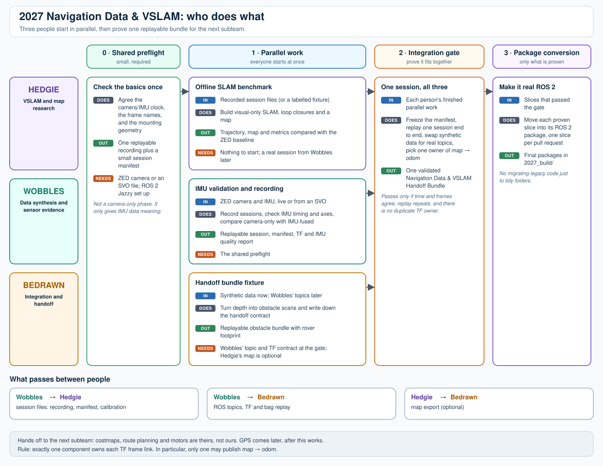
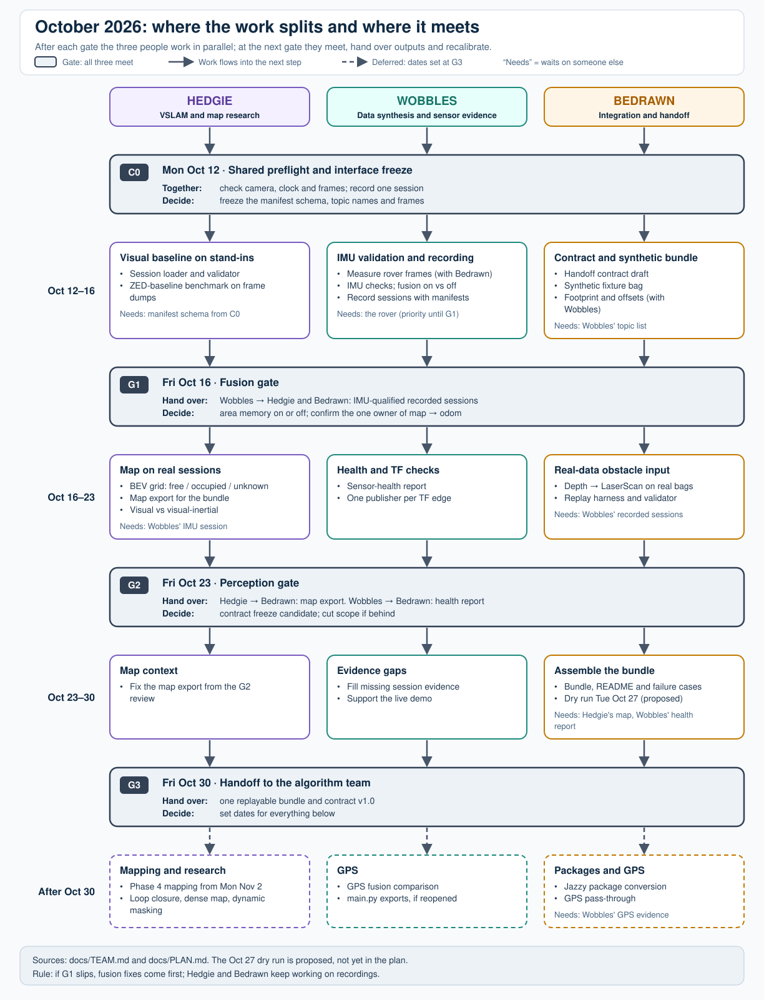

# Team: Data Synthesis, VSLAM, and Integration

Who owns what, how the three people's work fits the October plan, and when we meet. The phases, gates and tasks themselves are in [PLAN.md](PLAN.md) and [TASKS.md](TASKS.md).

## Our boundary

This subteam turns raw or synthetic rover observations into a **validated, replayable navigation-data bundle**. We own data synthesis, sensor/session evidence, visual SLAM, map/obstacle exports, and integration of those outputs into one documented handoff.

The next subteam (the algorithm team) owns everything after that boundary: costmap construction, route/goal choice, planner/controller configuration, recovery behavior, and motor integration.

## Our three responsibilities

| Responsibility | What this subteam produces | Does not own | Person / branch | Plan |
| --- | --- | --- | --- | --- |
| **Data synthesis and sensor evidence** | synthetic fixtures, replayable SVO/rosbag sessions, manifest, TF/URDF, IMU timing/quality, GPS evidence later, known-failure labels | VSLAM research conclusions | Wobbles / `wobbles-sensor-localization` | [people/WOBBLES.md](people/WOBBLES.md) |
| **VSLAM and map research** | visual-only and visual-inertial trajectory comparisons, loop closures, map/occupancy/semantic exports, metrics | live-sensor acquisition | Hedgie / `hedgie-slam-research` | [people/HEDGIE.md](people/HEDGIE.md) |
| **Integration and next-subteam handoff** | synthetic/replay adapters, obstacle-input contract, footprint/offset metadata, the final replayable bundle | costmap construction, planners/controllers, route choice, motors | Bedrawn / `bedrawn-nav-integration` | [people/BEDRAWN.md](people/BEDRAWN.md) |

The labels describe responsibilities, not a rule that only one person can help. The branch names are the merge boundaries, and a merge is not required for another workstream to begin. The legacy root-level prototype only receives narrow, reviewed changes via `main`.

[Full-size diagram](diagrams/pipeline.svg). Lanes are people; columns are the stages below. Regenerate it after changing its content with `python3 docs/diagrams/scripts/generate_pipeline_svg.py`.

## Big overall deliverable

Deliver one **Navigation Data & VSLAM Handoff Bundle** containing:

1. A stable session manifest plus replayable recorded and/or synthetic data.
2. Time-aligned RGB-D, IMU, pose/odometry, TF, diagnostics, and tracking-status evidence.
3. VSLAM trajectory/map outputs, with visual-only versus visual-inertial comparison when synchronized IMU data exists.
4. A documented obstacle source (`LaserScan` and/or `PointCloud2`) and optional map context (`OccupancyGrid`), including frame, timestamp, range/confidence, and marking/clearing semantics.
5. Measured rover footprint, sensor mounting offsets, route/environment metadata, replay instructions, and known failure cases.

The next subteam must be able to validate and consume this bundle without reading the legacy prototype or needing live hardware. For October, the bundle's topics and formats are the ones in [CONTRACT.md](CONTRACT.md).

### What passes between people

| Contract | Producer | Consumer | Required content |
| --- | --- | --- | --- |
| Session/fixture manifest | Wobbles | Hedgie, Bedrawn | calibration, frames, timestamps, checksums, route/environment metadata, known failures |
| Sensor evidence | Wobbles | Hedgie, Bedrawn | RGB-D, IMU, pose/odometry, diagnostics, tracking status, replay instructions |
| VSLAM/map evidence | Hedgie | Bedrawn | trajectory, map/occupancy context, frame, resolution, confidence/provenance, evaluation results |
| Handoff bundle | Bedrawn | Next subteam | obstacle source, TF/localization context, footprint/offsets, map context, replay evidence, failure semantics |

## Done means

- The same session/fixture replays deterministically enough to inspect the supplied topics, transforms, and outputs.
- The frame and timestamp conventions are explicit, and exactly one component owns each supplied TF edge.
- VSLAM and sensor outputs identify their provenance and quality limits rather than claiming guaranteed navigation accuracy.
- The bundle exposes inputs and evidence only; it does not contain a costmap, planner, controller, goal-selection policy, or motor command.

## Boundary rules

1. Use standard ROS 2 message types at the subteam boundary whenever possible.
2. Keep the root-level prototype runnable; do not move it into `2027_build/` as unrelated cleanup.
3. One component owns each TF edge. Do not publish competing `map -> odom` transforms.
4. Keep generated SVO, rosbag2, maps, models, and large experiment outputs out of Git unless an approved artifact store or Git LFS is used.
5. Agree on manifest and handoff fields before changing cross-workstream code, then add one small tested producer, exporter, or fixture at a time.

---

## Delivery stages

Each person's plan is organised in these five **stages**. They are not the same as the phases in [PLAN.md](PLAN.md): stages describe one person's order of work, phases describe the whole October build. The dates below map one onto the other.

1. **Shared measurement preflight:** establish camera/IMU timing, fixed physical frames, and one replayable recording. This supplies the evidence needed to interpret IMU measurements; it is not a separate camera-only feature phase.
2. **Parallel work:** Wobbles creates/records replayable sessions and validates IMU evidence; Hedgie establishes visual and visual-inertial trajectory/map evidence; Bedrawn prepares the synthetic fixture and final handoff contract.
3. **Bundle gate:** verify one replayable handoff bundle against the manifest, sensor-topic/TF, VSLAM map/trajectory, obstacle, and single-`map -> odom` contracts.
4. **Package conversion** (after Oct 30): convert only the pieces proven at the bundle gate. Do not migrate the legacy prototype merely to fill the workspace.
5. **GPS** (after Oct 30): evaluate global localization after the local stack and its replay evidence are stable.

The responsibilities can start independently, but all three are complete only when their evidence is assembled into the validated handoff bundle.

## What can run at the same time

[Full-size diagram](diagrams/schedule_flow.svg). Regenerate it with `python3 docs/diagrams/scripts/generate_schedule_svg.py` after changing the dates or tables below.

Mostly everything, after the shared preflight: each person starts against stand-ins (synthetic fixtures, frame dumps, `fake_pose`). These items still wait on someone else, compete for the rover, or fall outside the October scope. Numbers are prompt numbers in each person's plan; "shared" prompts are [below](#agent-prompts).

| Work | Waits on | Ready by | Until then |
| --- | --- | --- | --- |
| Hedgie session IO (3), Bedrawn fixture and contract (3, 4) | Manifest schema (shared 2) and Wobbles' topic list (Wobbles 4) | C0, Mon Oct 12 | Draft against [CONTRACT.md](CONTRACT.md) |
| Wobbles frames (3) and Bedrawn footprint (6) | The rover, in one tape-measure session | Before G1, Fri Oct 16 | Not applicable: do it together |
| Live camera time | Wobbles has priority until G1 (PLAN rule 5, fusion first) | G1, Fri Oct 16 | Hedgie and Bedrawn work from recordings |
| Hedgie visual vs visual-inertial (11), Bedrawn real data (8) | An IMU-qualified session (Wobbles 7, 11) | G1, Fri Oct 16 | Synthetic fixture and frame dumps |
| Hedgie map export (12) | Bedrawn's contract draft (Bedrawn 3) | C0 draft; frozen at G2 | Export the local-grid format in CONTRACT §1 |
| Bedrawn bundle (9) | Hedgie map export (12) and Wobbles health report (10) | G2, Fri Oct 23 | Bundle without map context |
| Hedgie research VSLAM (6, 7, 8, 10), dynamic masking (9) | Out of October scope; would take time from G2 | After G3, Fri Oct 30 | Visual baseline only (3 to 5) |
| `main.py` exports (Wobbles 8) | Conflicts with decision D8 (`main.py` untouched) | After Oct 30, if reopened | Bag topics replace them |
| Package conversion to Jazzy (Bedrawn 10) | Bundle gate passed | After G3 | The October Humble packages |
| All GPS work (Wobbles 12, Hedgie 13, Bedrawn 11) | Wobbles GPS evidence; out of October scope | After G3 | None |

## Sync meetings

Each gate in [PLAN.md](PLAN.md) is also a meeting for all three people: check the evidence, recalibrate the plan, and agree on what changes. The Oct 27 dry run is a proposed addition to the plan; without it, any problem with the handoff would first show up on Oct 30, the gate day itself.

| Date | Meeting | Wobbles brings | Hedgie brings | Bedrawn brings | Decide or recalibrate |
| --- | --- | --- | --- | --- | --- |
| **Mon Oct 12** (C0) | Interface freeze | Topic list, frames, preflight session | Loader running on frame dumps | Contract draft, synthetic fixture | Freeze the manifest schema and topic names. If anything is still open on Oct 13, close it before Oct 16. |
| **Fri Oct 16** (G1) | Fusion gate | TF tree, IMU checks, fusion on/off report, recorded bags with manifests | Baseline benchmark on a real session | Measured footprint and offsets | Area memory on or off; confirm the single `map -> odom` owner. Hedgie and Bedrawn switch to real bags. If G1 fails, fusion fixes come first and the others continue on recordings. |
| **Fri Oct 23** (G2) | Perception gate | Health signal and sensor-health report | BEV grid and map export on recorded sessions; visual vs visual-inertial comparison | Scan adapter on real bags, replay harness | Contract becomes a candidate for freezing (later changes need a version bump). If behind, cut in PLAN rule 7 order: YOLO objects, confidence layer, area memory. |
| **Tue Oct 27** (proposed) | Handoff dry run | Any missing session evidence | Map context for the bundle | Draft bundle, replayed by the algorithm team | Fix list for the last three days. |
| **Fri Oct 30** (G3) | Handoff and review | Live demo support | Map context | Bundle and contract v1.0 | Set dates for Phase 4 mapping, Hedgie's research VSLAM, Jazzy package conversion, and GPS. |
| Sat Oct 31 | Buffer | Fixes only | Fixes only | Fixes only | No new features. |
| **Mon Nov 2** | Phase 4 kickoff | Area-memory re-test | Mapping approach options | Map-topic contract additions | Mapping approach decision (M1). |

---

## Agent prompts

Each person's plan ends with copy-paste prompts for an AI coding agent (or a teammate), in stage order. Each prompt has a due date and lists what it waits on. A prompt marked **not this month** is outside the October scope; its date is set at the Oct 30 review.

### Shared preamble

Start every prompt with this, filling in your plan file and branch:

> **Preamble.** You are working in the `autonomous_navigation` repo. Before writing code, read `docs/README.md`, `docs/TEAM.md`, and `<your plan file in docs/people/>`. Work on branch `<your branch>`. Until Oct 30, 2026, `docs/PLAN.md` is the working plan: Ubuntu 22.04 / ROS 2 Humble, the ZED wrapper owns `map -> odom` and `odom -> base_link` (decision D4), `main.py` stays untouched (D8), and topic names follow `docs/CONTRACT.md`. After that, the long-term target is Ubuntu 24.04 / Jazzy. Rules: exactly one component owns each TF edge (`map -> odom -> base_link -> camera_link -> imu_link`); no costmaps, planners, controllers, or motor commands; keep SVO, bags, and large outputs out of Git. If a fact is not in the docs or the data, write "to be decided" instead of inventing it.

### Stage 1: shared measurement preflight (all three, due C0 Mon Oct 12)

These two prompts are shared. Each person's plan numbers its own prompts from 3.

1. **Preflight checklist.** "Write a preflight script and checklist that verifies the ZED stream opens (live or SVO), the timestamp convention, the frame ids, and the measured `base_link -> camera_link -> imu_link` geometry. Record one replayable session with a minimal `manifest.json` that matches `docs/contract/session_manifest.example.json`. Output a pass/fail report."
2. **Freeze the manifest schema.** "Compare `docs/CONTRACT.md` §12 with `docs/contract/session_manifest.example.json`. Propose one JSON Schema for the session manifest and a validator with tests. List every field where they disagree." *All three agree on it at C0; everyone's loaders and fixtures build against it.*
